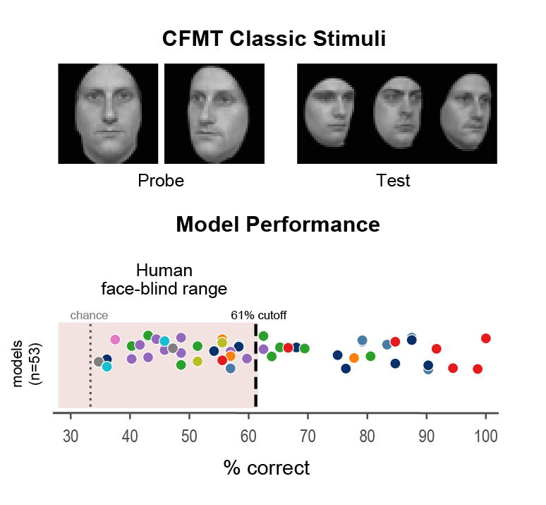

# Standardized Human Tests Show That Most Vision Models Are Face-Blind



Read the [paper](https://www.biorxiv.org/content/10.64898/2026.09.18.750666v1) (NeurIPS 2026 Interp4Discovery Workshop)

### How to run
All code needed for replication is available in the `dpnt/` folder. CFMT, CFMT-AUS, and CFMT+ are not publically available datasets and must be requested access from the respective authors.

`results/results_cfmt.csv` holds the results of the 53 models for the CFMT. Most models work out of box, but a few need to be downloaded (info below)

### Model checkpoints

Most models download automatically. Six need a checkpoint downloaded once by hand; the sweep skips them if no path is given.

Put the files anywhere (e.g. `checkpoints/`) and pass their paths via `model_checkpoints`:

```python
local_model_checkpoints = {
    "arcface_r50_webface600k": "checkpoints/w600k_r50.onnx",
    "arcface_r50_ms1mv3": "checkpoints/ms1mv3_arcface_r50/backbone.pth",
    "resnet50_vggface2_official": "checkpoints/resnet50_ft_weight.pkl",
    "resnet50_robust_l2_eps3": "checkpoints/resnet50_l2_eps3.ckpt",
    "resnet50_toponet_tau30": "checkpoints/",
    "resnet18_toponets_tau10": "checkpoints/",
}
```

#### Checkpoints to download by hand

| Model | Registry name | Download |
|---|---|---|
| ArcFace R50, WebFace600K | `arcface_r50_webface600k` | [InsightFace](https://github.com/deepinsight/insightface) |
| ArcFace R50, MS1MV3 | `arcface_r50_ms1mv3` | [arcface_torch model zoo](https://github.com/deepinsight/insightface/tree/master/recognition/arcface_torch#model-zoo) |
| VGGFace2 ResNet-50 | `resnet50_vggface2_official` | [VGGFace2-pytorch](https://github.com/cydonia999/VGGFace2-pytorch#pretrained-models) |
| Robust ResNet-50, L2 ε=3 | `resnet50_robust_l2_eps3` | [Madry Lab robust ImageNet models](https://huggingface.co/madrylab/robust-imagenet-models) |


#### TopoNet models(`resnet50_toponet_tau30`, `resnet18_toponets_tau10`)
for toponets, function auto-downloads. just do 
```python
local_model_checkpoints[resnet50_toponet_tau30] = "checkpoints/resnet18_tau_30.pt"
local_model_checkpoints[resnet18_toponets_tau10] = "checkpoints/resnet18_tau_10.pt"
```
however you will need to pip install topoloss to run these models:
```bash
pip install git+https://github.com/toponets/toponets.git
```
